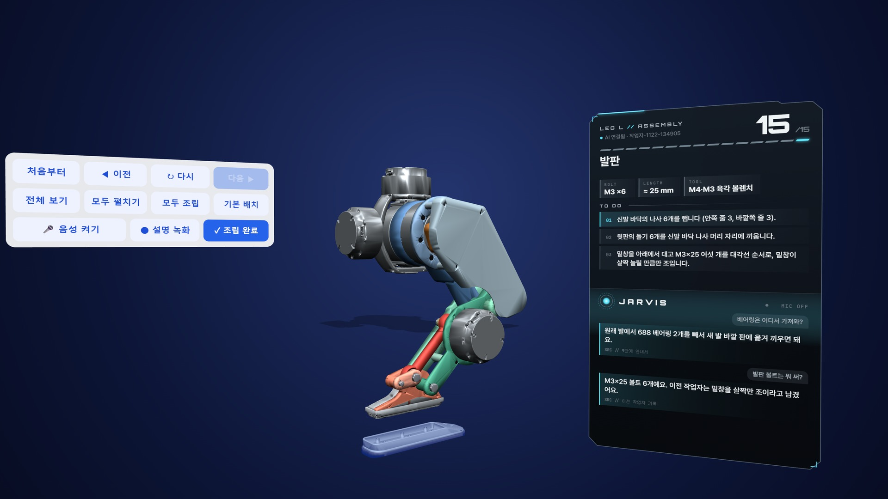
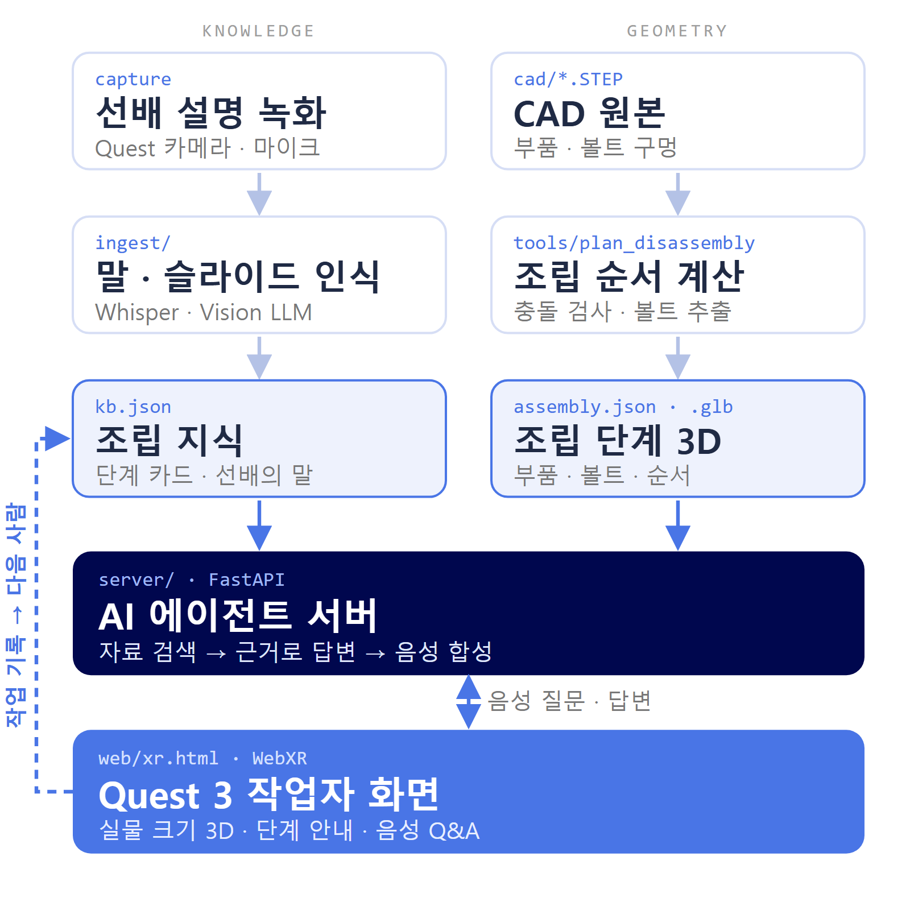

# 로봇 분해·재조립 XR 도우미

> **XR Assembly Assistant with a Voice AI Agent** — CG&I × KAIST 2026 XR·AI Winter School Hackathon (Nov 21–22, 2026)
>
> A Meta Quest 3 mixed-reality app that overlays a life-size, step-by-step CAD assembly on the real robot and lets a technician ask a voice AI agent ("Jarvis") questions while working. The agent answers only from the designer's own knowledge — slides and spoken explanations captured through the headset — plus notes left by previous builders, so assembly know-how survives when the designer leaves.
>
> **Stack**: WebXR · three.js · Python · FastAPI · WebSocket · faster-whisper · Supertonic / Edge TTS · OpenAI-compatible LLM · CadQuery (OCP) · trimesh

<p align="center"></p>

## 문제

연구실 로봇은 설계한 사람이 졸업하면 조립 요령도 같이 사라진다. 도면에는 "이 볼트는 살짝만 조여야 한다", "튜브 넣기 전에 안쪽 먼지를 불어라" 같은 말이 남지 않는다.

## 해결

설계자의 설명을 **헤드셋으로 녹화해 CAD 부품·단계에 묶어 두고**, 다음 작업자는 **Quest 3로 실물 크기 3D를 보며 말로 물어 가며** 혼자 조립한다. 작업자가 남긴 기록은 다시 다음 작업자의 지식이 된다.

**Capture → Represent → Transfer → Verify**

| 단계 | 하는 일 |
|---|---|
| Capture | 설계자가 PPT를 넘기며 설명하면 헤드셋 카메라·마이크로 녹화 → 슬라이드는 비전 LLM으로, 말은 Whisper로 읽어 기존 지식에 LLM으로 골라 합침 (반대되는 말은 "확인 필요"로 분리) |
| Represent | STEP 원본에서 부품별 3D 모델을 만들고, 형상 충돌 계산과 볼트 구멍 추출로 조립 순서·볼트·막힘 정보를 자동 생성 |
| Transfer | 패스스루 위 실물 크기 CAD로 단계별 조립 안내, 음성 질문에 근거만 써서 답변 ("4단계 렌치 몇 밀리?" → "2.5mm 육각 렌치") |
| Verify | 작업자별 기록(단계 시간·질문·마지막 한마디)을 모아 단계별 어려움 점수와 팁을 만들고 다음 작업자에게 전달 |

<p align="center"></p>

## 주요 기능

**XR 화면** (`web/xr.html`, three.js + WebXR)
- 실물 크기 CAD를 패스스루 위에 배치, 단계마다 부품·볼트가 날아 들어오는 조립 애니메이션
- 자유 분해: 손 핀치·컨트롤러로 부품을 잡아 빼기. 충돌로 막히거나 볼트로 고정된 부품은 안 빠지고 "먼저 ○○를 빼야 해요" 안내
- 양손 핀치로 확대·회전·이동, 손이 바쁠 때는 시선 1초 응시로 버튼 누르기
- 로봇 2종: 로봇팔 전완(14단계), 왼다리(15단계, 설계자 HTML 안내서에서 자동 변환)

**CAD 파이프라인** (`tools/`)
- `step_to_glb.py` STEP → 부품별 GLB
- `plan_disassembly.py` 형상 충돌 검사로 분해 가능 방향을 찾아 조립 순서 계산
- `add_bolts.py` STEP의 볼트 구멍 위치로 볼트 자동 생성 (전완 19개, 왼다리 38개)
- `guide_to_robot.py` 설계자 조립 안내서 + CAD → 로봇 데이터

**음성 AI 조수** (`agent/`, FastAPI 서버 하나로 3D와 AI를 함께 제공)
- 상시 듣기 → 짧은 명령("다음", "7단계")은 Whisper base, 질문은 small로 나눠 인식 속도와 정확도를 함께 확보
- 명령은 정규식으로 즉시 처리, 질문은 지식 검색 후 LLM이 근거만으로 답변 (근거 없으면 "자료엔 없어요")
- "이거/여기"는 현재 단계 부품으로, "N단계"는 그 단계로, "카본 튜브 쓰는 단계?"는 전체 단계에서 번호와 이름으로 답
- 노트북에서 도는 한국어 신경망 TTS(Supertonic), 숫자 한글 읽기, 쉼표 단위로 나눠 앞 조각부터 재생
- 끊긴 WebSocket을 8초 핑으로 감지해 재연결, 그 사이 질문은 잃지 않고 다시 전송
- API 키가 없어도 규칙·검색·로컬 음성만으로 동작

## 개발하며 풀었던 문제들

헤드셋 실측에서 드러난 문제를 하나씩 고쳤다 (`git log`에 증상 → 원인 → 해결로 기록).

- **대답 없이 "생각 중"에서 멈춤**: Wi-Fi가 잠깐 끊기면 요청이 매달림 → STT 20초 타임아웃, 서버 쪽은 밀린 요청을 건너뛰고, 답이 안 온 질문은 재연결 후 재전송
- **잡음을 "M5, M5, M5…"로 받아 적어 명령이 실행됨**: Whisper 온도 재시도가 2초 잡음에 30초를 씀 → 온도 고정·토큰 수 제한·되풀이 결과 폐기
- **질문이 단계 이동으로 처리됨**: "7단계에서 볼트 몇 개야?"가 7단계로 이동 → 이동 명령은 전체 일치일 때만
- **근거 없는 답을 지어냄**: "왼쪽 오른쪽 같아?"에 "구분 없다"고 답함 → 근거에 좌·우 언급이 없으면 "자료엔 없어요"
- **설명 녹화 전사의 환각**: 힌트 단어를 되풀이하는 결과 → 두 번 전사해 멀쩡한 쪽 선택, 문맥으로 인식 오류 교정
- **헤드셋 옆 설계자 목소리가 안 담김**: 소음 제거가 화자 외 목소리를 지움 → 녹화 때 소음 제거 끄고 음량 정규화

## 실행

Windows, Python 3.12 기준.

```powershell
python -m venv .venv
.venv\Scripts\python -m pip install -r requirements.txt -r agent\requirements.txt
copy agent\.env.example agent\.env      # LLM 키 (없어도 동작)
powershell -ExecutionPolicy Bypass -File agent\run_https.ps1
```

- 노트북: http://localhost:8000/xr/xr.html (마우스로도 동작)
- Quest 3: 같은 Wi-Fi에서 `https://<노트북 IP>:8443/xr/xr.html` → 인증서 경고에서 계속 → START AR

CAD가 바뀌었을 때 (원본 CAD는 저장소에 포함하지 않음, `cad/`에 직접 넣기):

```powershell
.venv\Scripts\python tools\step_to_glb.py cad\forearm.STEP web\assets\forearm.glb
.venv\Scripts\python tools\plan_disassembly.py cad\forearm.STEP web\assets\forearm.assembly.manual.json web\assets\forearm.assembly.json
```

시험: `agent/tests/simulate.py`(작업자 2명 흉내, 키 없이 동작), `agent/tests/eval_questions.py`(질문 정답 평가)

## 폴더

| 경로 | 내용 |
|---|---|
| `web/xr.html` | XR 화면 |
| `web/assets/` | 로봇별 3D 모델(`.glb`), 조립 순서·볼트·막힘(`.assembly.json`) |
| `tools/` | CAD 파이프라인, Quest 연결·디버그 |
| `agent/serve.py` | 서버 진입점 (8000 http + 8443 https, 자체 서명 인증서 자동 생성) |
| `agent/server/` | 질문 처리, 지식 검색, LLM, 로컬 STT/TTS, 작업 기록 집계 |
| `agent/ingest/` | 설계자 자료 → 지식 (슬라이드 읽기, 녹음 전사, 합치기) |
| `agent/data/kb/` | 로봇별 조립 지식 |
| `docs/` | 구조 문서([HANDOFF.md](docs/HANDOFF.md)), 시연 영상 구성 |

## 남은 과제

- 전완 1~3단계 순서는 형상 계산으로 방향을 못 찾아 수동 지정
- 볼트 규격·길이는 구멍 크기로 추정한 값
- 일부 부품은 CAD 이름(Part19 등) 그대로
